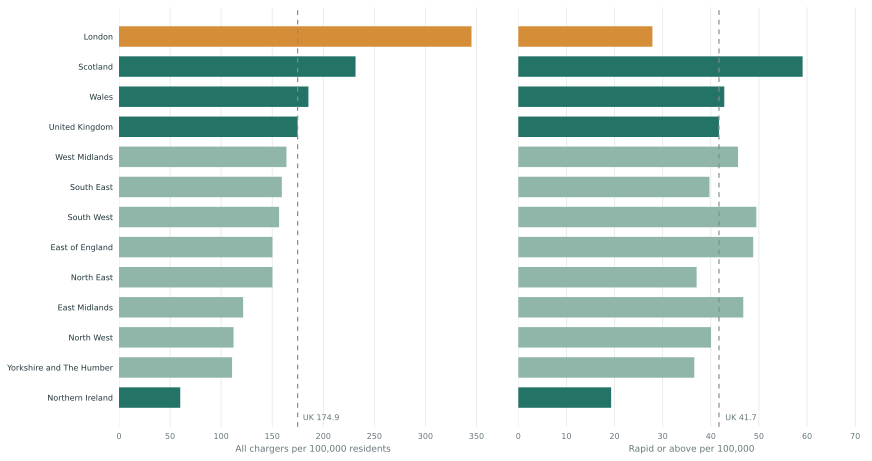
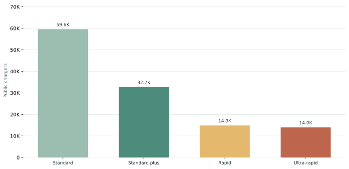
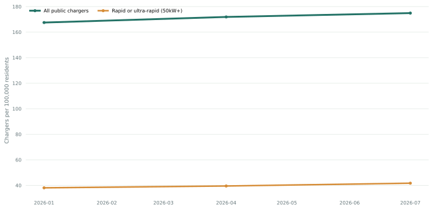

<a href="https://aloysius109.github.io/">← Portfolio home</a>

Public EV charging | United Kingdom | Data at 1 July 2026

The UK had **121,171 public electric-vehicle chargers** on 1 July 2026. That works out to **174.9 per 100,000 residents**, but the national average conceals a wide local spread. Hammersmith and Fulham had the highest local rate; North East Derbyshire had the lowest.

::: {.metric-row}
::: {.metric-card}
121,171
Public EV chargers across the UK
Reported operational on 1 July 2026
:::
::: {.metric-card}
174.9
Chargers per 100,000 residents
UK-wide rate
:::
::: {.metric-card}
28,887
Rapid or ultra-rapid chargers
50kW or above
:::
:::

## The map changes when speed matters

London had the highest regional provision overall, at **345.1 chargers per 100,000 people**. But only **27.9 per 100,000** were rapid or ultra-rapid. Scotland had fewer chargers overall, at 231.6 per 100,000, yet more than twice London’s rapid-and-above rate: 59.1 per 100,000.

{fig-alt="London has the highest total charger rate but a below-average rapid-or-above rate. Scotland has the next-highest total rate and the highest rapid-or-above rate. Northern Ireland has the lowest total rate."}

The number of plugs alone does not describe how useful a network is for a particular trip. DfT classifies chargers from standard (3kW to under 8kW) through standard plus, rapid (50kW to under 150kW) and ultra-rapid (150kW and above). Almost half of UK public chargers were in the standard band.

{fig-alt="The UK had 59,587 standard chargers, 32,697 standard plus, 14,891 rapid, and 13,996 ultra-rapid chargers."}

## Explore a local authority

Select one of the 361 local authorities to see its latest charger count, provision per 100,000 residents, rapid-and-above provision, and the three quarterly readings available for 2026.

  
Loading local-authority charger data...

## A new series, with an early data caveat

The national per-capita series has moved upward since January, though three quarterly readings are too few to establish a long-term trend. The chart shows only the new EV-charger measure, introduced on 1 January 2026.

{fig-alt="Both UK charger rates per 100,000 residents increased across three readings from January to July 2026; the all-charger rate is higher than the rapid-and-above rate."}

The Department for Transport changed its measure from **charging devices** to **EV chargers** on 1 January 2026. The local selector therefore shows the three quarters in the new series, rather than joining it to older device counts as if the measures were identical.

There is also a specific caveat for the latest quarter. In June 2026, one charge-point operator removed about 1,270 private-access chargers that had been incorrectly reported as public. DfT says this may affect comparisons between April and July. A fall in a local count should therefore not automatically be read as chargers being physically removed.

## What the rate can—and cannot—tell us

Chargers per 100,000 residents makes areas of different population sizes easier to compare. It does not measure how evenly chargers are distributed within an area, whether they are available or working, how much they cost, or how many drivers use them. City-centre areas can serve commuters and visitors as well as residents. Treat the rate as a broad coverage indicator, not a measure of an individual driver’s access.

## Data and method

The analysis uses the Department for Transport’s July 2026 public EV charger tables. Local-authority rates use DfT’s published population-adjusted estimates, based on ONS-sourced boundaries and mid-year 2024 population estimates. We checked that the 361 local-authority rows sum to the DfT national totals of 121,171 chargers and 28,887 chargers rated 50kW or above. DfT labels this release **official statistics in development**.

- [DfT July 2026 statistics and commentary](https://www.gov.uk/government/statistics/electric-vehicle-charging-infrastructure-statistics-1-july-2026/public-electric-vehicle-charging-infrastructure-statistics-1-july-2026)
- [DfT data tables (EVCI)](https://www.gov.uk/government/statistical-data-sets/electric-vehicle-charging-infrastructure-statistics-data-tables-evci)
- [ONS population estimates](https://www.ons.gov.uk/peoplepopulationandcommunity/populationandmigration/populationestimates)
- [Open Government Licence v3.0](https://www.nationalarchives.gov.uk/doc/open-government-licence/version/3/)

Independent analysis by Kathryn Hopkins. Data downloaded 13 November 2026. The charger statistics are reused under the Open Government Licence v3.0.

## Related reports

- [The affordability squeeze](https://aloysius109.github.io/housing-affordability-report/) — both reports compare local-authority patterns across England and Wales.